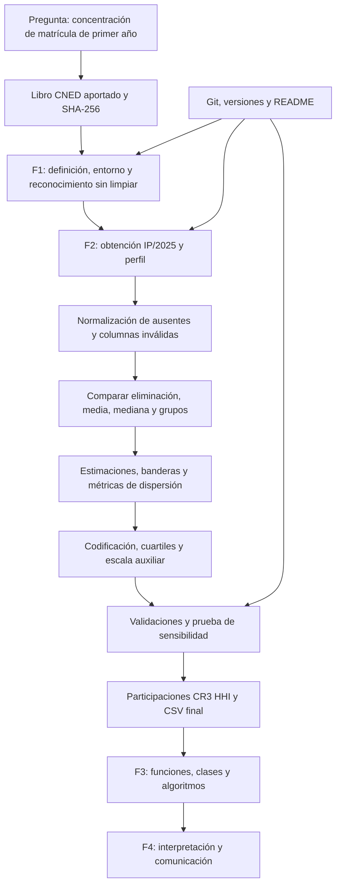

# Mapa conceptual técnico — Fases 1 y 2, CNED 2025

| Elemento | Tipo según rúbrica | Estado | Evidencia |
|---|---|---|---|
| Python, pandas, NumPy, lxml, Jupyter | Herramientas | Implementado | F1 §2; F2 §1, requirements.txt |
| Ingesta y auditoría de calidad | Procesos | Implementado | F2 §2-3; src/cned_pipeline.py |
| Fuente→extracción→validación→salida | Flujo reproducible | Implementado local | data/raw, interim, processed; tests/ |
| Ausencia, imputación, monedas, cuartiles | Decisiones técnicas | Implementado | Registro_decisiones.md; comparacion_imputaciones.csv |
| Ramas, estructura F1–F4 y README | Organización repositorio | Preparado, **no publicado** | README; GitHub pendiente |
| Narrativa, código, salidas, métricas | Estructura notebooks | Implementado y ejecutado | F1/*.ipynb; F2/*.ipynb |
| Algoritmos OOP y visualización final | F3/F4 proyectadas | Futuro | F3/README.md; F4/README.md |

**Justificación:** el mapa organiza la planificación conceptual alrededor de evidencias verificables del problema. El pipeline medido responde a esa planificación sin atribuir trabajo de F3/F4 a esta entrega. No se reclama un commit inexistente ni un acceso no acreditado.
